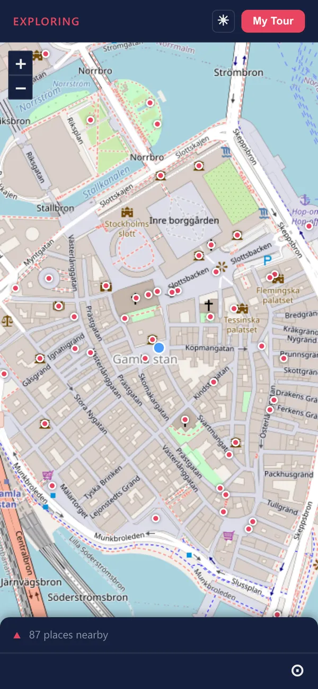

# Guided Tour

A mobile web app for exploring places on foot, as a free-roam companion or a guided itinerary. Built as a helper for amateur tour guides, and for anyone who wants a short, useful story about the place they are standing in.

**[Open the app →](https://maxfinnsjo.github.io/guided-tour/)** (best on a phone, allow location access)

## What it does
- **Free roam:** walk around anywhere. When you get within 80 m of a point of interest, a flash card pops up with what is worth knowing: name, type, opening hours, architect, year built and a Wikipedia extract when there is one.
- **Tour mode:** import a list of stops (JSON or CSV) and step through them in order. The app tracks your progress and marks each stop as visited when you arrive.
- **FAQ per place:** the questions guests ask most, with short answers.
- **Offline-friendly:** installable, with a service worker for when the signal drops between the old-town alleys.

## How it is built
Vanilla JavaScript with Vite and Leaflet. Maps from OpenStreetMap, places from the Overpass API, facts from Wikipedia and Wikidata. No backend and no accounts. The idea came from Steps & Stops Tours, a walking-tour business I ran in Stockholm.

## Source
The source code is private, because the app is part of something I may build a business on. This repository holds the presentation and the live build. Code access is available on request, see my portfolio for contact details: [max.contigomedia.se/portfolio](https://max.contigomedia.se/portfolio/).

Built with Claude Code as pair programmer; design, product decisions and review by Max Finnsjö. © Max Finnsjö, all rights reserved.
